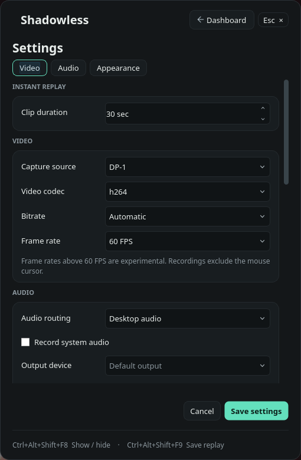
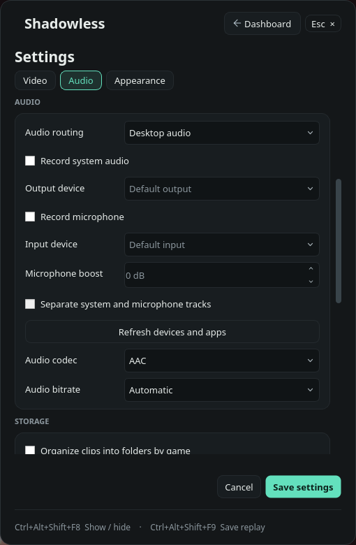
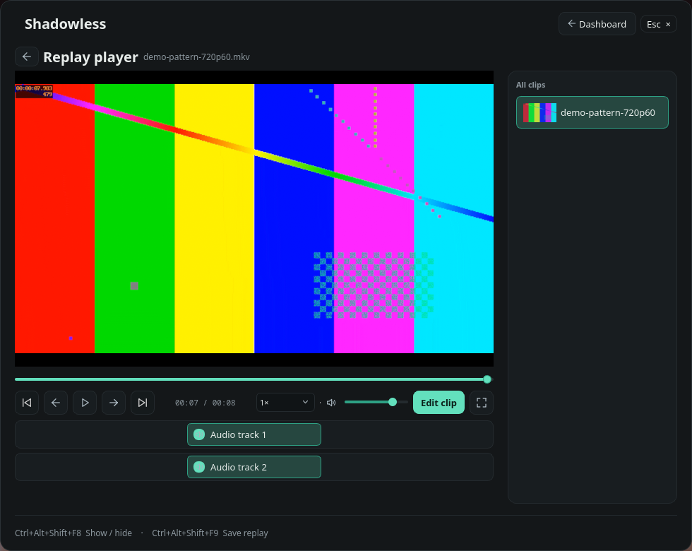

# Shadowless - An app for clipping

  

**Developed with AI assistance, including OpenAI Codex.** This is a fork of
Captail by FaulMit; original attribution and licensing are retained.
See [AI disclosure](docs/AI_DEVELOPMENT.md) and the
[Windows / Linux feature comparison](docs/FEATURES.md).

[Windows installer / releases](https://github.com/Zefth051/Shadowless/releases) ·
[Linux AppImage releases](https://github.com/Zefth051/Shadowless/releases?q=linux-v) ·
[Installation guide](docs/INSTALL.md)

**Capture engines:** Windows uses OBS components (`libobs`), included in the
installer and Portable package; OBS Studio does not need to be installed.
New Linux builds bundle a Shadowless-managed GPU Screen Recorder (GSR) engine,
built from source maintained in the Linux branch. No separate GSR installation or
GSR interface is needed. The existing 0.2.4 draft still requires host GSR.

  
  

## Current release status

**Public source; binary releases are not published yet.** The Windows 0.3.0 draft
contains Setup and Portable packages with final-only public updates enabled. The Linux draft contains
`Shadowless-0.2.4-linux-x86_64.AppImage`; binaries are attached to Releases,
not included in the source ZIP. Public source access does not grant access to
unpublished drafts; viewing them requires sufficient repository permissions. See [available packages and pending validation](docs/RELEASE_STATUS.md).

| | Windows edition | Linux edition |
| --- | --- | --- |
| Interface / capture | WPF/.NET and libobs | Qt 6 and a managed GSR engine |
| Target | Windows 10/11 x64 | Hyprland on native Wayland, x86_64 |
| Capture | Desktop and direct game capture | Monitor capture through GSR |
| Distribution | Setup EXE / Portable ZIP | AppImage; managed GSR, host PipeWire and FFmpeg |
| Real in-app upgrade | Not yet tested | Not yet tested |

The editions have separate interfaces and platform requirements. See the
[full comparison](docs/FEATURES.md). Existing 0.2.4 drafts and Linux development
builds update manually; new Windows Release builds include final-only public
update checks, ready for the public transition. Automated
updater tests do not establish a successful upgrade between two released versions.
[Windows native package upgrades passed](docs/WINDOWS_UPDATE_VALIDATION.md);
the complete published-release/UI path remains pending.
See [updates and local work](docs/UPDATES_AND_LOCAL_WORK.md) for the release process.

Shadowless saves recent gameplay and makes continuous recordings. This branch
contains the native Linux edition for Hyprland on Wayland, powered by GPU
Screen Recorder. The [Windows edition](../../tree/windows) uses WPF and libobs.

See the [Linux build and usage guide](linux/README.md) for dependencies,
shortcuts, capture settings, and validation. See [publishing both branches](docs/GITHUB.md)
for repository setup.

Shadowless is based on [Captail by FaulMit](https://github.com/FaulMit/captail)
and retains its [GPL-2.0-or-later license](LICENSE).

## Hardware testing

Shadowless hardware testing has only been performed on this `linux` branch with
an NVIDIA GeForce GTX 1650, Hyprland / Wayland and GPU Screen Recorder.
Other GPUs and Windows capture have not been validated by this project.
RTX test reports belong to upstream Captail on Windows, not Shadowless.
Automated Windows package upgrade checks do not establish capture compatibility.

## Linux preview screenshots

Real captures of the `linux-v0.2.4` AppImage on Hyprland. Capture is off; the
library/player/editor use a synthetic demo pattern. These images do not claim
recording performance or Windows behavior. [All six captures and provenance](docs/screenshots/linux/README.md).

  
  

