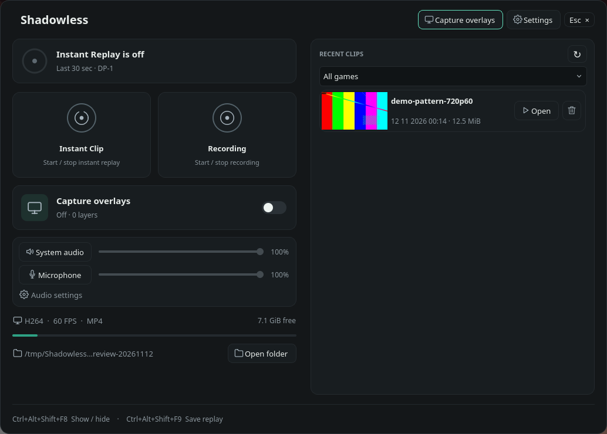
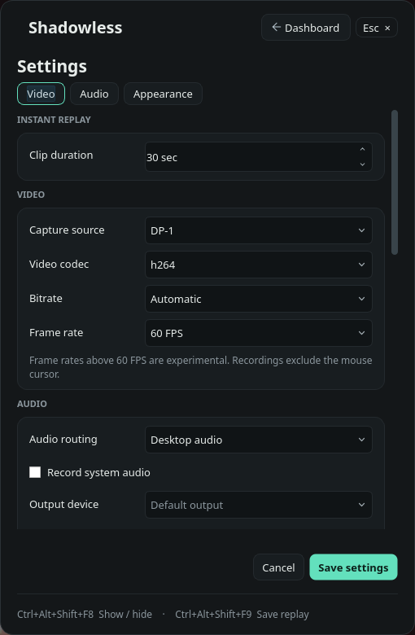
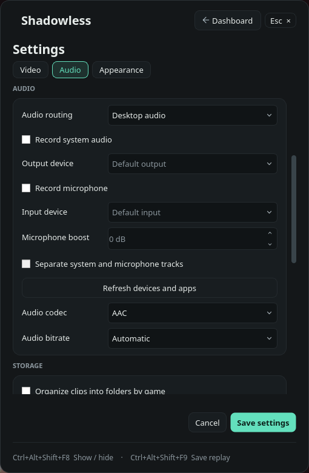
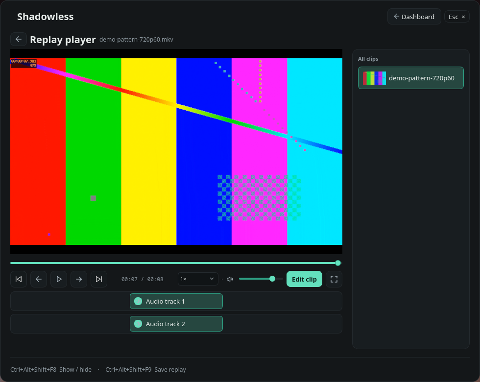
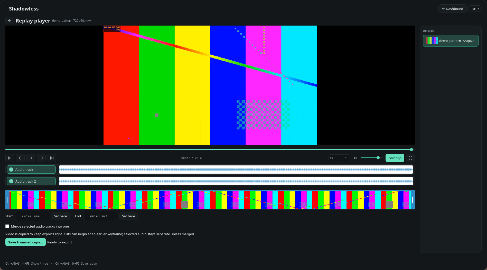
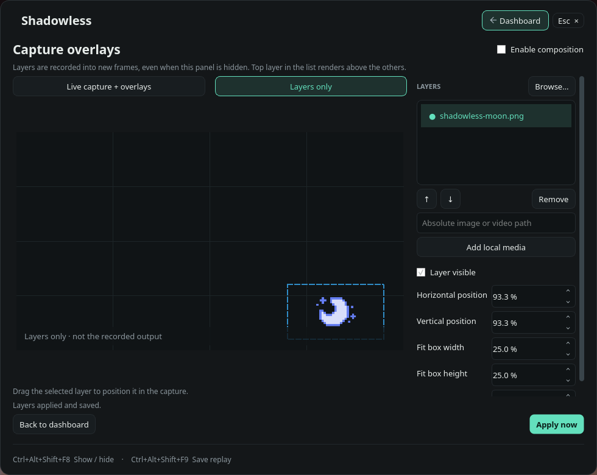

# Linux AppImage screenshots

Captured on 2026-11-12 from the real Qt/Wayland application on Hyprland.
These images show the private Linux candidate, not the Windows interface.

- Candidate: `linux-v0.2.4`, source commit `d5ed159591c41c8ddd98ca5e82858642fb918c9b`.
- AppImage: `Shadowless-0.2.4-linux-x86_64.AppImage` downloaded from the GitHub draft.
- AppImage SHA-256: `5f0ecac6db2df13096d951b829d7864adfeb0ad3b8fad01311251ba7a7adb7af`.
- Version command: `shadowless 0.2.4`; release checksum verification passed.
- Host: CachyOS/Arch, native Hyprland/Wayland, 1920×1080 at scale 1.
- Method: `grim` crops of the actual panel at native resolution; no retouching,
  relabeling, UI reconstruction or upscaling. Desktop chrome is excluded.
- Settings and runtime were isolated from the user's running instance. Recording,
  replay capture and audio capture were off throughout this session.
- Media: an eight-second FFmpeg `testsrc2` pattern at 1280×720/60 FPS, H.264,
  with two synthetic AAC sine-wave tracks. This demonstrates real library,
  playback and editor controls; it is not game footage or capture-performance evidence.
- Overlay media: the repository's existing `linux/app/assets/shadowless-moon.png`.
  The editor shows Layers only with composition disabled; no recorded output is claimed.

## Dashboard and library

## Video settings

## Audio settings

## Player

## Editor

## Media overlay editor

PNG hashes are recorded in [SHA256SUMS.txt](SHA256SUMS.txt). These captures do not
validate native Windows, clean-host Linux recording, or in-app upgrades.
